# Menu Engineering Bot

**Universal POS Analytics · Menu Engineering · Pricing Intelligence · Forecast Evaluation · AI Decision Support**

A Streamlit application that transforms restaurant and coffee-shop sales exports into an interactive business-intelligence dashboard, menu-performance analysis, **exploratory** pricing scenarios, historical demand-model evaluation, and AI-assisted decision memos.

Built for heterogeneous point-of-sale (POS) CSV files: it adapts source columns into a canonical schema, validates input quality, checks analytical capabilities, and clearly identifies assumptions when transaction-level cost or pricing evidence is incomplete.

> **Principle:** Python computes the financial metrics and pricing scenarios. The language model explains structured results; it is not responsible for financial arithmetic. Simulated outcomes are not guaranteed profits or causal estimates.

> **Status:** Local application implemented and tested. Public deployment is not claimed here.

## Dashboard preview

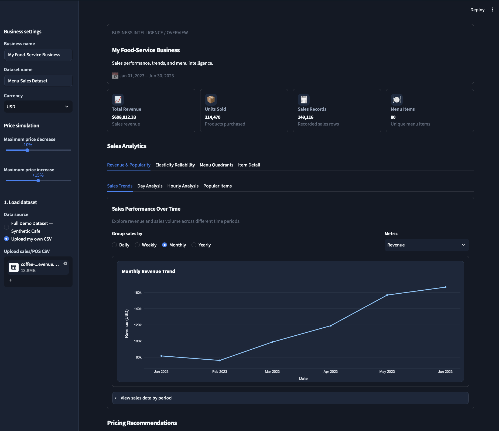

*Dashboard using an external coffee-shop transaction dataset: 149,116 records, 80 items, and approximately $698.8K in observed revenue. The external dataset is not bundled in this repository.*

## What it does

| Capability | Description |
| --- | --- |
| **Universal CSV/POS ingestion** | Detects common delimiters, suggests mappings using aliases and conservative fuzzy matching, and allows manual corrections. |
| **Validation and provenance** | Checks dates, quantities, prices, and optional costs; reports potential source duplicates and data-quality issues without silently removing transactions. |
| **Capability-aware analysis** | Keeps sales and revenue features available when costs are missing; clearly distinguishes observed costs from assumed-cost scenarios. |
| **Sales intelligence** | Revenue trends, item popularity, daily/hourly analysis, category filters, and item-level exploration. |
| **Menu engineering** | Classifies items as Stars, Plowhorses, Puzzles, or Dogs using popularity and contribution margin when costs are available. |
| **Elasticity and reliability** | Estimates observational price–demand relationships where evidence permits; otherwise discloses category or default priors and their limitations. |
| **Pricing intelligence** | Tests bounded price moves with Base case and Conservative objectives, simulated contribution impacts, and downside-risk flags. |
| **Historical model evaluation** | Compares a historical-average demand baseline against a log-log elasticity model using a chronological train/test split **when data eligibility requirements are met**. |
| **AI decision memos** | Uses Anthropic Claude to explain computed findings, supported by limited numerical-claim checks and Markdown/TXT/PDF exports. |
| **Testing** | Unit and regression tests plus Streamlit AppTest coverage for key interactions. |

## Feature gallery

### 1. Universal data ingestion and reliability checks

The app supports different POS column layouts and maps them into the fields needed for analytics. A data audit and capability summary explain what is available before cost-dependent features run.

| Column mapping | Data capabilities and cost assumptions |
| --- | --- |
| 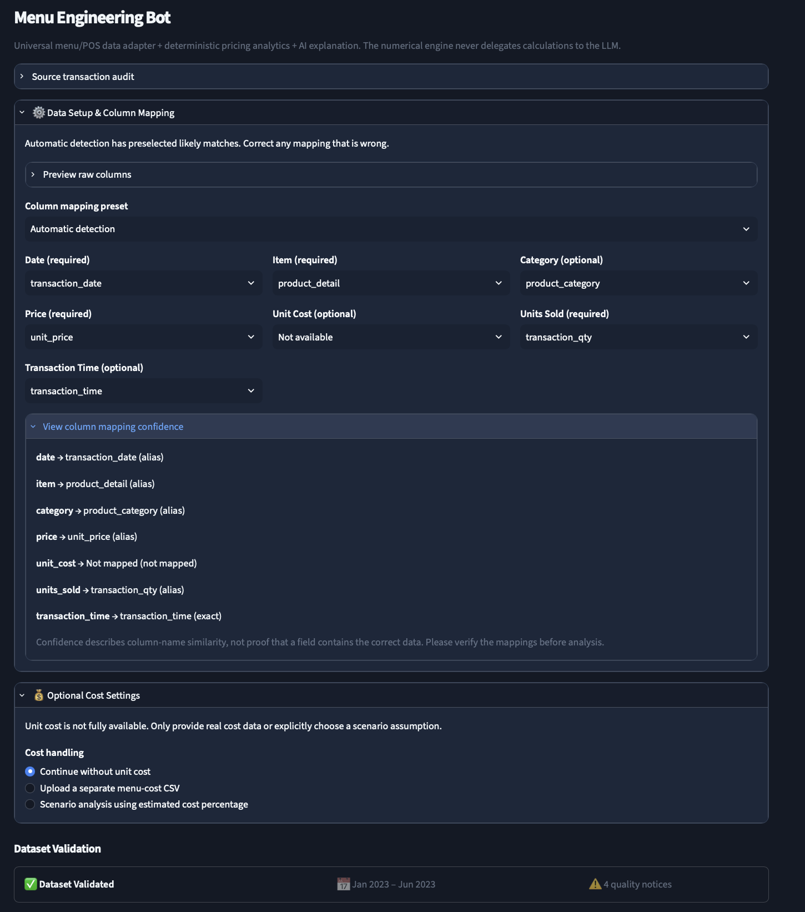 | 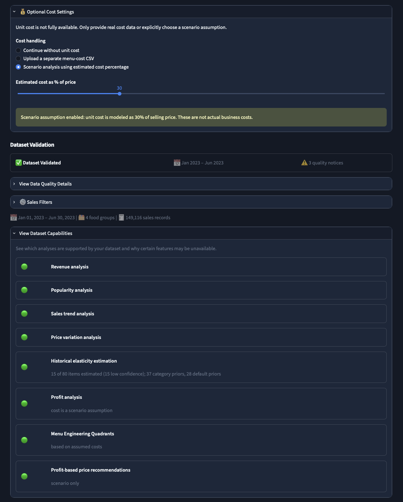 |

**Costs are not inferred from selling prices.** When actual per-unit costs are unavailable, users may proceed with revenue-only analyses, upload a separate cost file, or explicitly choose an estimated-cost scenario. Profit and pricing outputs from assumed costs are labeled as simulations, not observed results.

### 2. Sales analytics and menu engineering

| Sales analytics | Menu engineering quadrants |
| --- | --- |
| 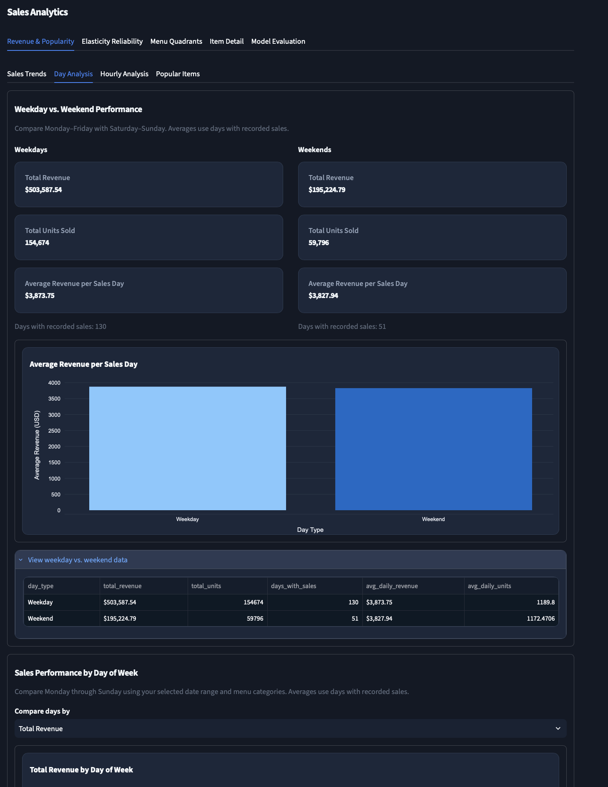 | 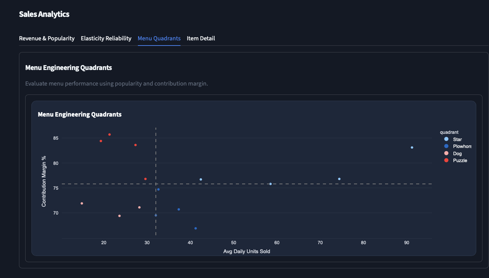 |

The quadrants combine **average daily units sold** (popularity) with **contribution margin percentage** (profitability), using dataset-specific thresholds. The quadrant screenshot illustrates the synthetic-cafe demonstration; the external POS screenshots demonstrate a different dataset.

### 3. Pricing simulation and risk

Recommendations compare candidate prices using item economics and elasticity inputs. The **Base case** selects a candidate based on central simulated contribution; the **Conservative** strategy prioritizes the modeled worst-case contribution among tested candidates.

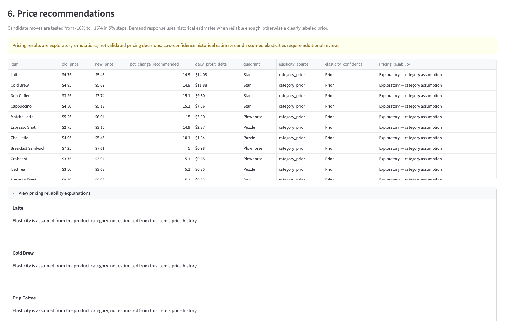

| Base case risk view | Conservative risk view |
| --- | --- |
| 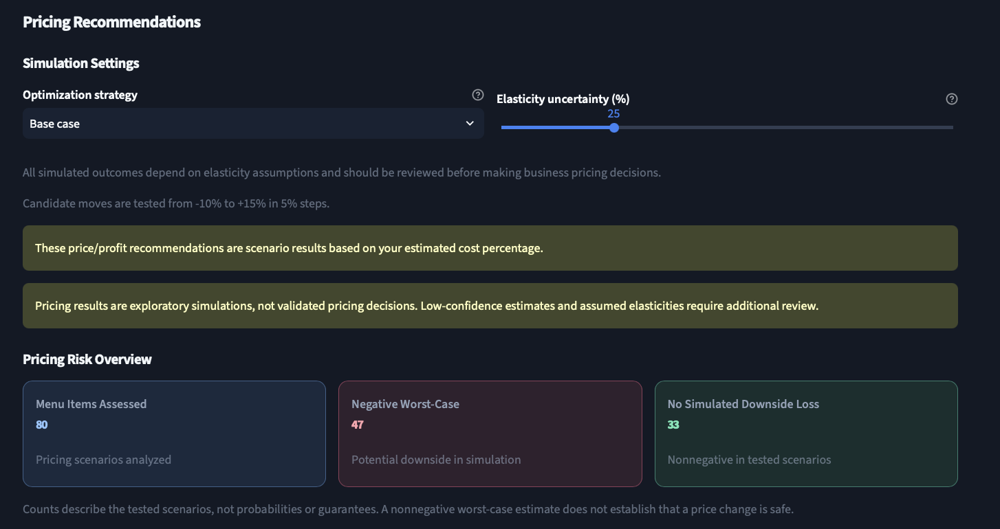 | 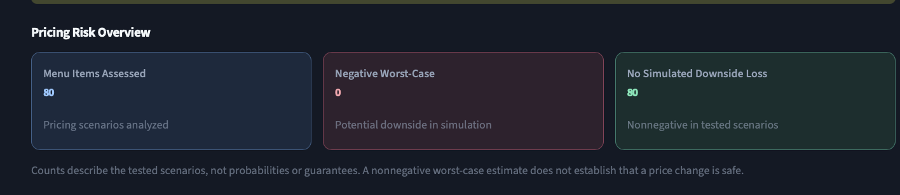 |

In the illustrated **external coffee-shop / 30%-of-price assumed-cost scenario**, the Base case flagged **47 of 80 items** as having negative modeled worst-case outcomes; the Conservative run showed **0 of 80** within its tested assumptions. **These counts are model outputs, not probabilities, guarantees, or evidence that any price change is safe.** The scenarios and strategy differ, so the images should not be interpreted as a causal experimental comparison.

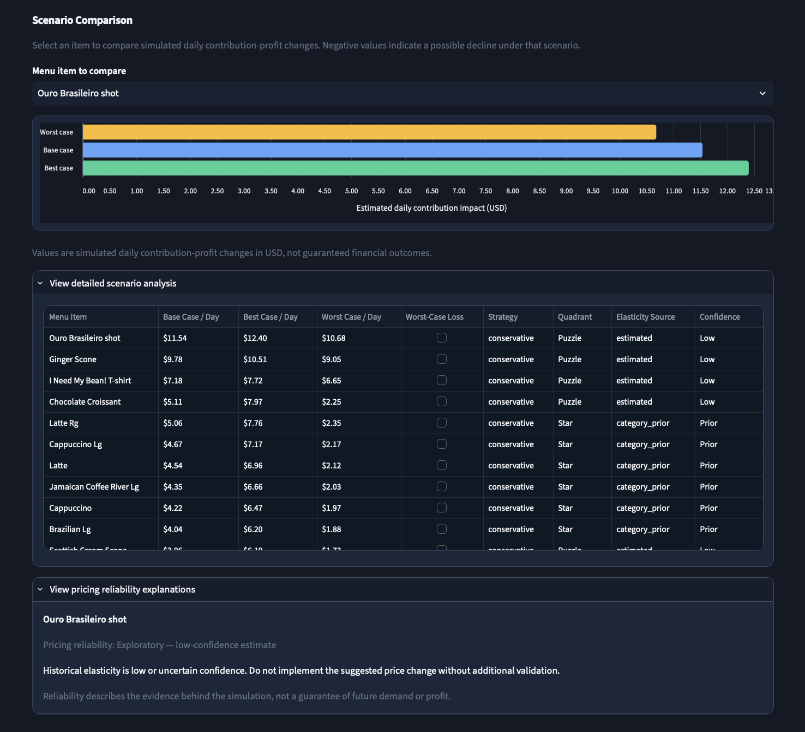

The model displays sensitivity to elasticity uncertainty and labels low-confidence historical estimates and prior-based assumptions. Historical correlations can be affected by promotions, seasonality, store differences, and other factors.

### 4. Model Evaluation — Backtesting with Eligibility Safeguards

The **Model Evaluation** tab evaluates historical demand forecasting performance by comparing a **historical-average baseline** against a **log-log elasticity-based forecasting model**.

The evaluation uses a chronological train/test split, training on earlier recorded dates and testing on later dates. Test-period prices are treated as known inputs, while test-period sales quantities are excluded from model fitting.

The evaluation reports three metrics when sufficient evidence is available:

- **MAE (Mean Absolute Error):** Average absolute difference between predicted and actual demand.
- **RMSE (Root Mean Squared Error):** Measures forecast errors while placing greater weight on larger errors.
- **WAPE (Weighted Absolute Percentage Error):** Measures absolute forecast error relative to total actual demand.

Missing transaction dates are not automatically assumed to represent zero sales.

#### Data Eligibility and Reliability Safeguards

The system requires sufficient historical observations, distinct training prices, and meaningful price variation before evaluating the elasticity model.

When these requirements are not met, the application reports **insufficient evidence** instead of generating unsupported accuracy metrics.

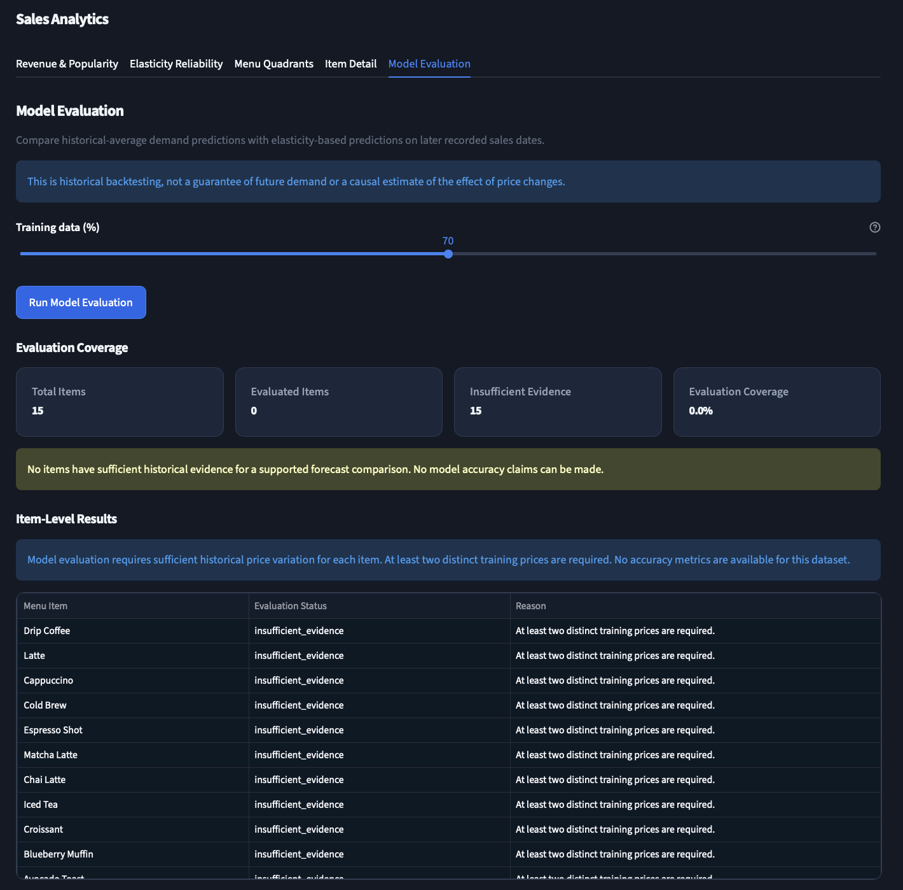

*Original Synthetic Cafe dataset: 15 menu items, with 0 eligible for the two-model comparison due to insufficient historical training-price variation. This represents a data limitation, not zero predictive accuracy.*

The dashboard also provides evaluation methodology details and downloadable JSON/CSV reports.

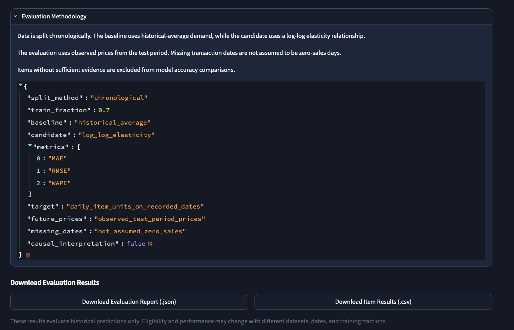

#### Successful Model Evaluation — Synthetic Backtesting Results

A separate **evaluation-ready synthetic dataset** was created to demonstrate the complete forecasting evaluation workflow.

The dataset contains:

- **8 menu items**
- **240 simulated sales days**
- Multiple historical selling prices
- Simulated demand fluctuations and price–demand relationships

Using a chronological **70/30 train/test split**, the following results were obtained:

| Evaluation Metric | Result |
|---|---|
| Total menu items | 8 |
| Successfully evaluated | 8 |
| Insufficient evidence | 0 |
| Evaluation coverage | **100%** |
| Items where the elasticity model achieved lower MAE | **8 of 8** |

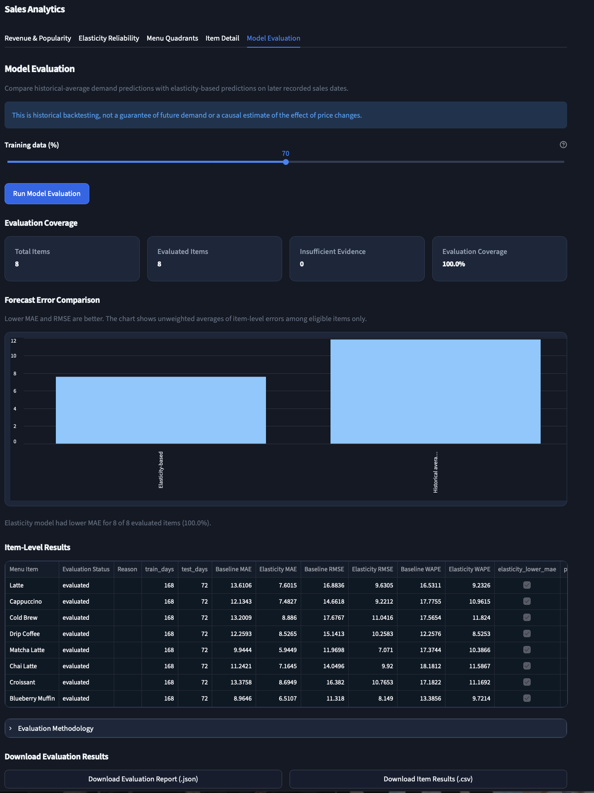

**Example: Latte Demand Forecasting**

| Metric | Historical-Average Baseline | Elasticity-Based Model |
|---|---:|---:|
| MAE | 13.61 | **7.60** |
| RMSE | 16.88 | **9.63** |

The elasticity-based model achieved lower held-out MAE than the historical-average baseline for all eight simulated menu items.

> **Important:** The synthetic dataset intentionally contains a simulated price–demand relationship. These results demonstrate the evaluation workflow under controlled conditions. They do not establish real-world forecasting accuracy, causal pricing effects, or guaranteed business outcomes.

#### Current Limitations and Planned Improvements

The current implementation requires sufficient historical evidence for the elasticity model before marking an item as successfully evaluated.

For real-world datasets with constant selling prices, historical-average forecasting may still be possible even when elasticity-based forecasting is unsupported.

A planned improvement will support three independent evaluation states:

1. **Baseline + Elasticity:** Both models can be evaluated and compared.
2. **Baseline Only:** Historical-average forecasting is supported, but elasticity evaluation lacks sufficient evidence.
3. **Insufficient Data:** Neither model has sufficient evidence for evaluation.

This improvement will make the forecasting evaluation more useful across real-world POS datasets without weakening its reliability safeguards.

### 5. AI-generated decision memo

The app sends structured, deterministic results to Anthropic Claude for a management-oriented narrative. It performs limited pattern-based checks on selected financial statements and invalidates a memo when its underlying inputs or pricing scenario changes. Human review is still required.

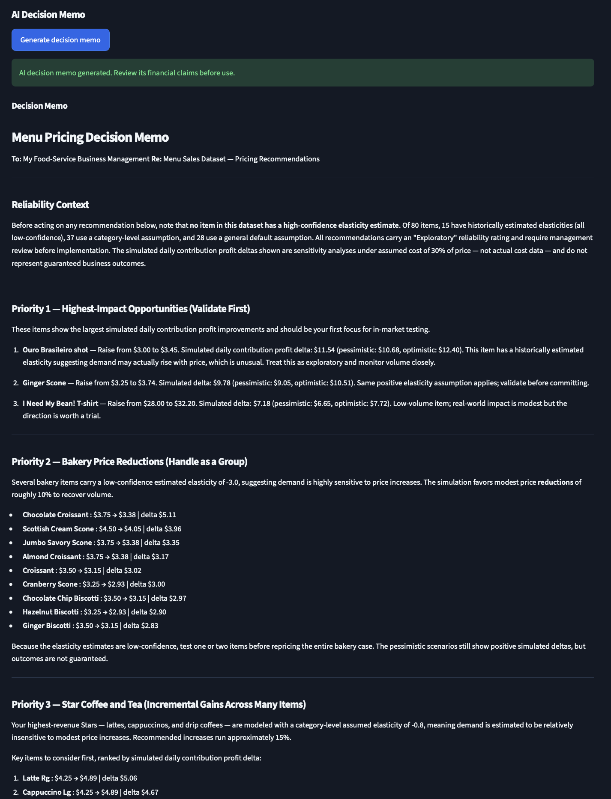

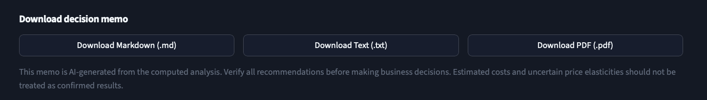

The screenshots featuring an 80-item coffee-shop dataset use a **30% assumed cost** for exploratory profit scenarios. They do **not** represent validated actual item costs.

## Quick start

**Prerequisites:** Python 3.12 recommended, pip, and a terminal.

```bash
git clone https://github.com/stephaniepatriciaans/menu-engineering-bot.git
cd menu-engineering-bot
python3 -m venv venv
source venv/bin/activate
python3 -m pip install -r requirements.txt
python3 -m streamlit run src/app.py
```

Open **http://localhost:8501**. The sidebar defaults to the bundled **Full Demo Dataset — Synthetic Cafe**; no external CSV or API key is required for the deterministic analytics.

On Windows, activate with `venv\Scripts\activate` instead.

### Optional AI memo setup

```bash
cp .env.example .env
```

Add your own API key to `.env`:

```dotenv
ANTHROPIC_API_KEY=your_api_key_here
```

Keep secrets out of Git. Without a configured key, sales, menu, elasticity, and pricing analytics remain usable; AI memo generation is unavailable. API usage may incur provider charges.

## How to use the app

1. Choose the bundled demo or upload a POS CSV.
2. Confirm the suggested date, item, quantity, price, and optional category/cost mappings.
3. Read the transaction audit, validation notices, and capabilities summary.
4. Select a cost basis: recorded cost, separate cost file, transparently assumed cost percentage, or revenue-only mode.
5. Explore trends, item-level metrics, and menu quadrants.
6. Compare pricing strategies and inspect modeled risk and scenario assumptions.
7. Run Model Evaluation separately when the dataset contains usable dated item/price/quantity histories.
8. Optionally generate and review an AI memo, then export the result.

## Data schema

| Canonical field | Requirement | Description |
| --- | --- | --- |
| `date` | Required | Transaction/sale date |
| `item` | Required | Product/menu-item name |
| `price` | Required | Per-unit selling price |
| `units_sold` | Required | Quantity sold |
| `category` | Optional | Product category; may default to `Uncategorized` |
| `unit_cost` | Optional | Per-unit cost for contribution and profit-based scenarios |
| `transaction_time` | Optional | Time-of-day analytics where present |

For example, POS fields `transaction_date`, `product_detail`, `transaction_qty`, and `unit_price` can be mapped to `date`, `item`, `units_sold`, and `price`. Users should check all suggested mappings before trusting results.

## Methods and interpretation

**Contribution profit (where cost is supplied):**

```text
Unit contribution = unit selling price - unit cost
Total contribution = unit contribution × units sold
```

**Menu quadrants:** Stars (high popularity / high contribution margin), Plowhorses (high / low), Puzzles (low / high), and Dogs (low / low). These categories are descriptive, not automatic instructions to change prices or remove items.

**Price–demand relationship:** An observational log-log specification relates `log(demand)` to `log(price)`. Historical estimates are distinguished from `category_prior` and `default_prior` assumptions. Without enough training-price variation, an elasticity forecast is not reported as evaluated.

**Backtesting:** The existing model-evaluation module uses a chronological split (70% train by default) and compares forecasts on later sales dates. Item eligibility may require multiple distinct training prices, enough observations, and a minimum price range. **Lower MAE/RMSE indicates better fit on this holdout only; it is not causal pricing evidence.**

**Price optimization:** Candidate price moves are evaluated under an explicitly selected strategy and elasticity-uncertainty level. The worst-case calculation is a **tested scenario**, not a statistically calibrated downside probability or an assured result.

## Project architecture

```text
POS CSV / Bundled synthetic cafe
          │
          ▼
CSV reader + schema mapping + transaction audit
          │
          ▼
Canonical adapter + validation + capability detection
          │
          ├──► Sales and revenue analytics
          ├──► Contribution + menu quadrants (if costs supported)
          ├──► Elasticity assumptions + pricing scenarios/risk
          └──► Historical model evaluation + coverage report
                          │
                          ▼
                Streamlit dashboard
                          │
                          ▼
              Optional Claude AI memo
                          │
                          ▼
             Memo audit + MD/TXT/PDF
```

| Location | Role |
| --- | --- |
| `src/app.py` | Main Streamlit application |
| `src/data_adapter.py` | CSV parsing, mapping, canonical schema and costs |
| `src/validation.py` | Data validation, transaction audit and capabilities |
| `src/analysis.py` | Menu analytics, margins, elasticity and pricing |
| `src/model_evaluation.py` | Chronological forecast evaluation, eligibility and report building |
| `src/ui/sections/model_evaluation.py` | Model Evaluation dashboard tab |
| `src/dashboard_utils.py` | Sales aggregation and chart-ready metrics |
| `src/agent.py` | Optional AI memo generation |
| `src/memo_validation.py` | Limited financial-claim consistency checks |
| `src/memo_export.py`, `src/pdf_report.py` | Memo exports |
| `src/ui/` | Styling and modular dashboard sections |
| `tests/` | Unit, regression and Streamlit AppTest checks |
| `scripts/` | Optional local utilities and dataset evaluation scripts |

## Demo data and reproducibility

- **Bundled Synthetic Cafe:** 15 menu items and 2,700 simulated sales records, with example unit costs; intended to demonstrate the main dashboard and pricing workflow.
- **External coffee-shop transactions:** 149,116 records and 80 menu items (Jan–Jun 2023), used to test ingestion and analytical behavior. Its raw transaction CSV is **not included** here; the profit-related screenshots use a 30% assumed-cost scenario.
- **Evaluation-ready synthetic cafe:** 8 items × 240 days, with simulated price changes and demand. Generated locally for forecast-evaluation demonstration; it should not be described as real validation data. The generator/output must be included separately if the README is intended to promise reproducibility from a fresh clone.

## Testing and quality

Install development dependencies:

```bash
python3 -m pip install -r requirements-dev.txt
```

Run checks:

```bash
PYTHONPATH=src python3 -m pytest -q
python3 -m ruff check src tests
python3 -m compileall -q src tests
```

For coverage, with `pytest-cov` installed:

```bash
PYTHONPATH=src python3 -m pytest --cov=src --cov-report=term-missing -q
```

**Last user-reported local verification:** 266 tests passed. Approximately 89% statement coverage was measured at an earlier milestone, so coverage should be rerun before claiming a newer exact percentage. Recently added Model Evaluation UI code and local scripts should receive dedicated regression/integration tests before being considered fully covered.

## Limitations and safeguards

- **No causal price-optimization claim.** Observational elasticity can be confounded by marketing, seasonality, geography and product substitution.
- **No invented costs.** Actual costs and estimated-cost scenarios are clearly distinguished.
- **No invented model accuracy.** The two-model evaluation currently requires eligible price histories; unsupported items are flagged instead of receiving made-up scores.
- **Baseline-only evaluation is not implemented yet.** Without sufficient elasticity evidence, the existing item comparison may omit baseline metrics that could otherwise be calculable.
- **Scenario outputs are conditional.** Modeled best/base/worst cases are not prediction intervals, guarantees or real-world safety certifications.
- **Memo checks have limited scope.** The AI memo still needs human review.
- **Upload performance depends on available memory and environment.** The app has not been presented as a production-hosted service.

## Technology

**Python · pandas · NumPy · Streamlit · Plotly · Altair · Anthropic Claude API · ReportLab · pytest · pytest-cov · Ruff · Git/GitHub**

## About

Created by **Stephanie Patricia Anshell** · [Portfolio](https://stephaniepatriciaans.github.io/portfolio/)

This project demonstrates data engineering, applied analytics, conservative statistical evaluation, scenario-based pricing, AI integration with deterministic numerical safeguards, and tested Streamlit application development.