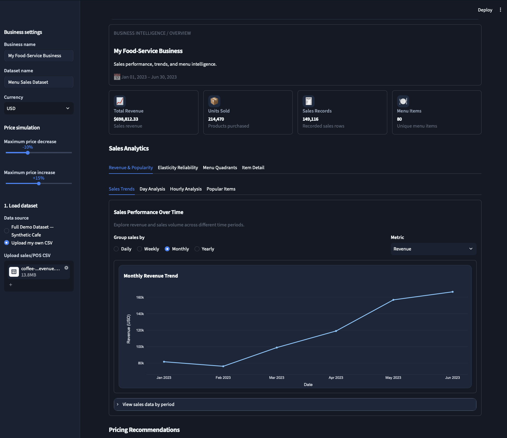
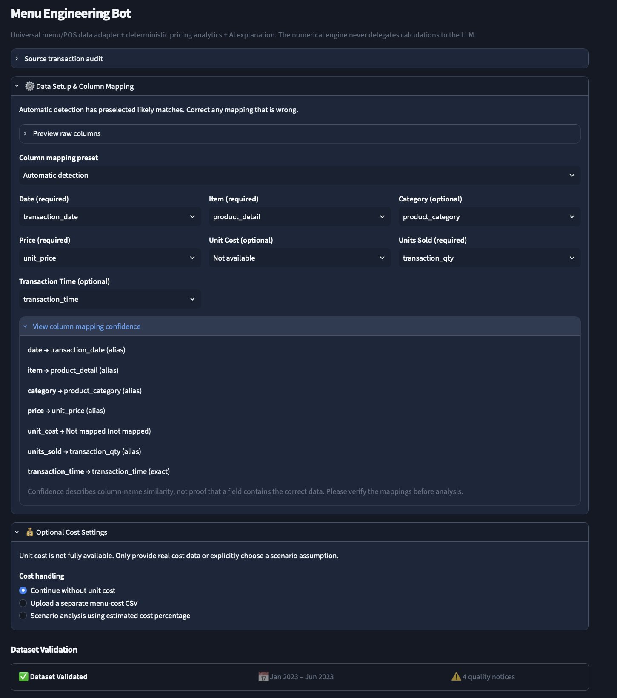
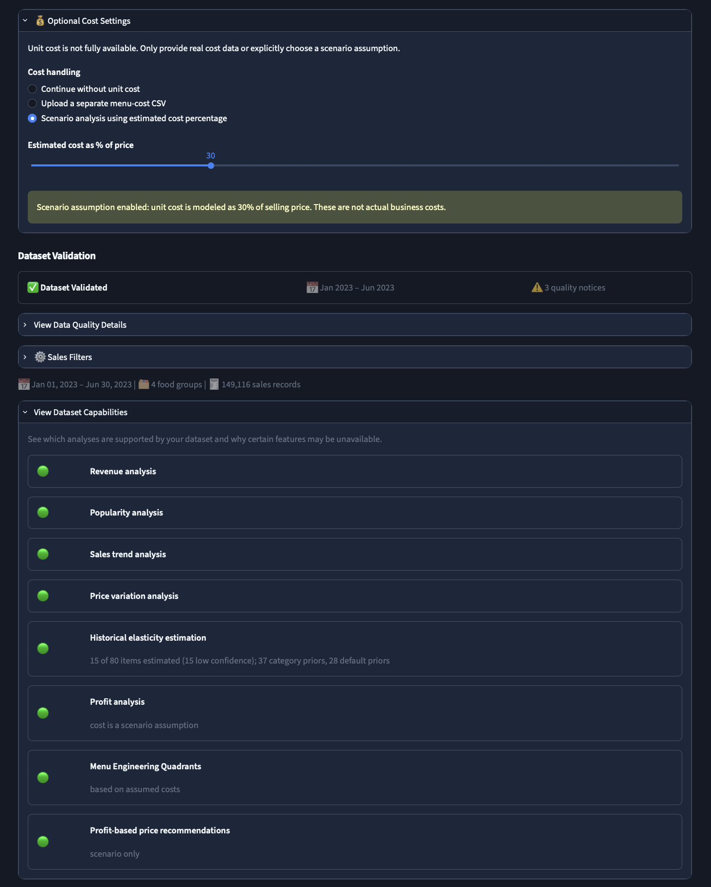
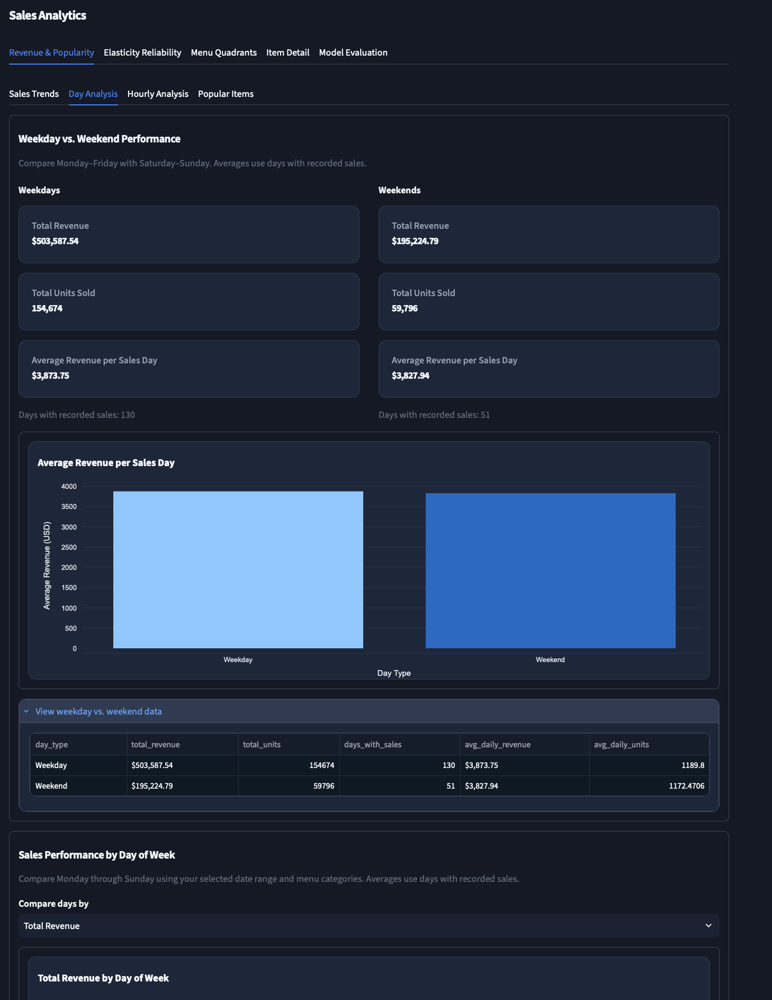
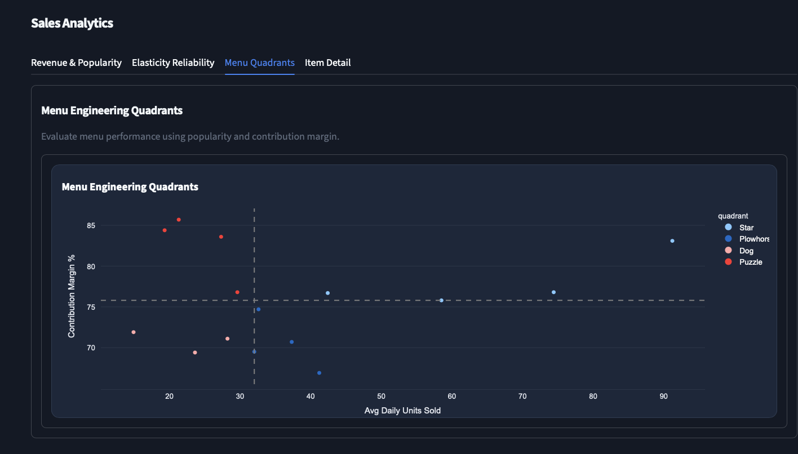
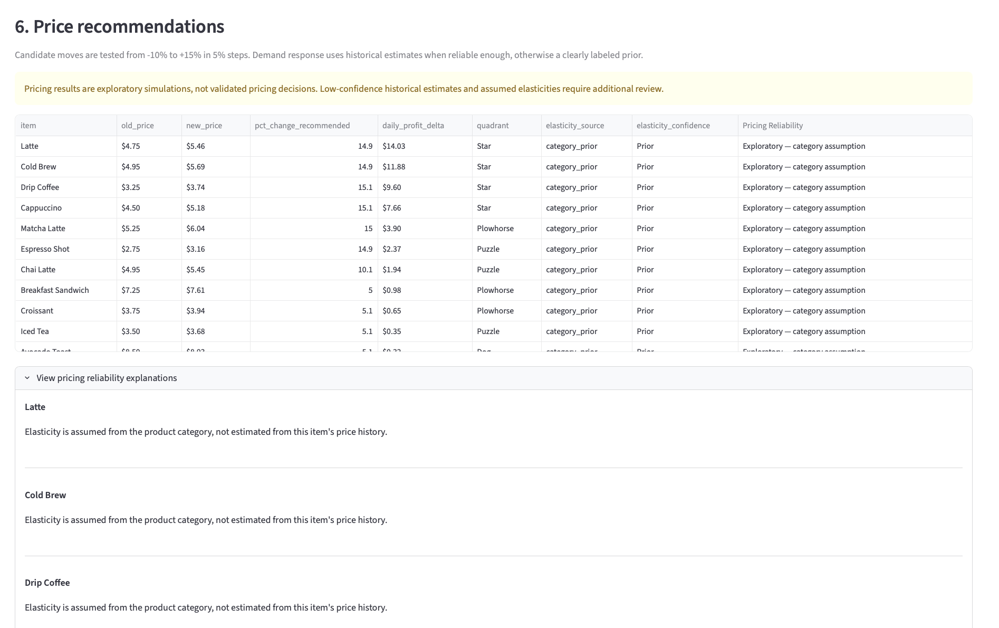
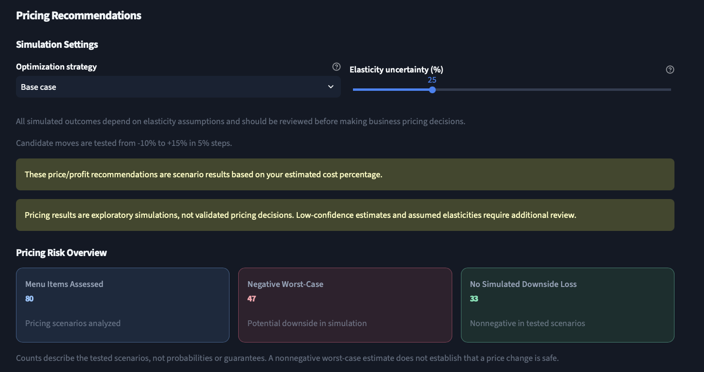
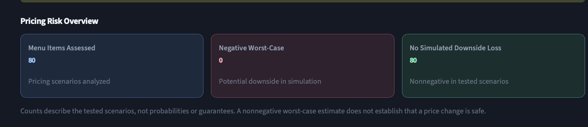
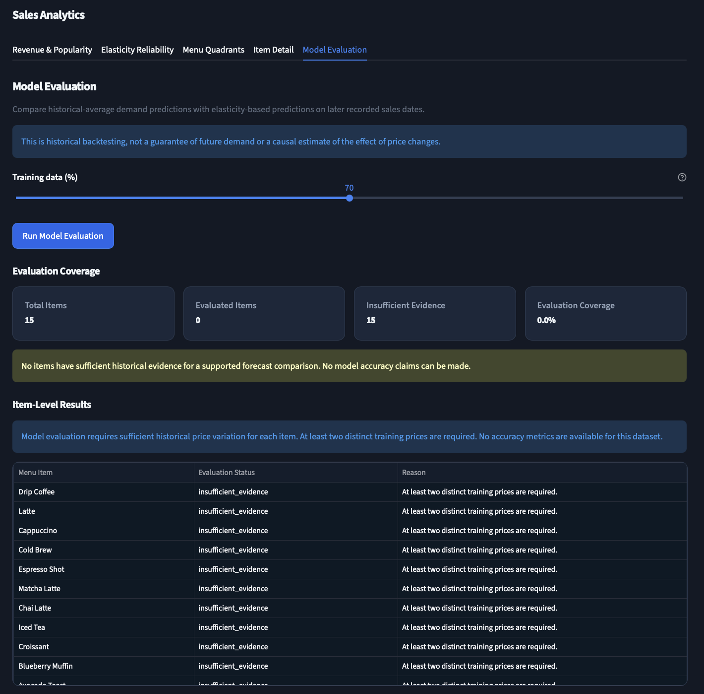

# Menu Engineering Bot

**POS Analytics · Menu Engineering · Demand Forecasting · Pricing Scenarios · AI Decision Support**

[](https://github.com/stephaniepatriciaans/menu-engineering-bot/actions/workflows/ci.yml)
[](https://www.python.org/)
[](https://streamlit.io/)

**Menu Engineering Bot** is a Streamlit business-intelligence application that transforms restaurant, café, and point-of-sale (POS) exports into audited sales analytics, menu-performance insights, historical demand forecasts, and exploratory pricing scenarios. An optional Claude-powered memo explains the results without delegating financial arithmetic to an LLM.

**Core design principle:** preserve source transactions, distinguish observed figures from assumptions, and report when data is insufficient to support a calculation. Price scenarios are *not* causal estimates, guaranteed profits, or automatically approved price changes.



> The dashboard illustration uses an external coffee-shop dataset. That source dataset is not distributed in this repository; some historical screenshots use explicit assumed-cost scenarios.

## Highlights

| Area | Capabilities |
| --- | --- |
| **Flexible ingestion** | CSV and `.xlsx` uploads; selectable Excel worksheets; delimiter/encoding handling; automatic column suggestions with manual corrections. |
| **Data quality** | Source transaction audit, duplicate and menu-name review, source-row quarantine, and visible review reasons without silently rewriting original data. |
| **POS accounting safeguards** | Refund/cancellation candidate detection, transaction-status and signed-amount mapping, discount previews, and guarded financial reconciliation. |
| **Business intelligence** | Sales KPIs, trends, date/category filters, item popularity, and weekday/hourly analysis where supported. |
| **Menu engineering** | Stars, Plowhorses, Puzzles, and Dogs based on popularity and contribution margin when reliable cost inputs exist. |
| **Pricing scenarios** | Bounded price simulations, elasticity assumptions, uncertainty settings, and Base case/Conservative comparisons. |
| **Model evaluation** | Chronological historical-average baseline and log-log elasticity backtests with MAE, RMSE, WAPE, and eligibility coverage. |
| **Forecast reliability** | Paired, same-item comparisons; baseline-only reporting; extrapolation/outlier warnings; observed vs. predicted demand. |
| **Optional AI memo** | Claude narrative with limited numerical-claim checks, input-aware cache invalidation, and downloadable reports. |
| **Engineering** | 572 automated tests at the completed Part 7 milestone, Ruff linting, and GitHub Actions CI on pushes and pull requests. |

## Dashboard tour

The app is organized into four workflow tabs:

**1. Data Setup** — Upload CSV/Excel or use the bundled synthetic café dataset. Confirm date, item, unit price, quantity, and optional cost/category mappings. Additional POS fields can be mapped when present.

**2. Data Quality** — Review source-record integrity, menu naming, price consistency, refund/cancellation candidates, exclusions, and optional financial reconciliation. Source evidence remains available; a sales-only dashboard is not a verified net-revenue ledger.

**3. Analytics** — Explore sales performance, popularity, menu quadrants, elasticity reliability, item details, and forecast evaluation.

**4. Reports** — Review and export deterministic analysis and, when explicitly enabled, an AI-assisted management memo.

| Column mapping | Cost/capability checks |
| --- | --- |
|  |  |

| Sales analytics | Menu quadrants |
| --- | --- |
|  |  |

### Pricing and uncertainty

Pricing recommendations are **scenario calculations**, not experimental estimates of the effect of changing a menu price. When observed item costs are missing, cost-dependent conclusions are either unavailable or visibly labeled as assumption-based simulations.



| Base case | Conservative scenario |
| --- | --- |
|  |  |

## Forecast evaluation and reliability

The historical evaluation splits each eligible item's **recorded dates chronologically** (70% training by default). The historical-average baseline is evaluated independently. The log-log elasticity model is compared only when training data provides sufficient price variation and other required evidence.

| Evaluation outcome | Meaning |
| --- | --- |
| **Both models evaluated** | Baseline and elasticity predictions have valid held-out errors for the same item. |
| **Baseline only** | Historical-average forecasts can be evaluated, but elasticity evaluation is unsupported. |
| **Insufficient evidence** | Neither model meets the required historical-data criteria. |

The dashboard reports **MAE**, **RMSE**, and **WAPE**, item-level status and reasons, baseline/comparison coverage, and downloadable evaluation results. It also shows paired-model win counts, mean/median error, and warnings about test prices outside the training range or unusually large elasticity errors.

**Recorded dates with no transactions are not treated as zero-demand days.** Elasticity test predictions may use observed held-out prices as inputs, but not held-out sales quantities for fitting. Historical backtesting does not establish causal price responsiveness.

### Real-world benchmark: UCI Online Retail

A local test with the UCI Online Retail workbook (not bundled with this repository) yielded the following **70/30 chronological evaluation**:

| Metric | Result |
| --- | ---: |
| Source records inspected | 541,909 |
| Eligible sales-only rows | 530,104 |
| Distinct menu/product items in evaluation | 4,015 |
| Items with baseline evaluation | 1,116 (27.8%) |
| Items with paired model comparisons | 447 (11.1%) |
| Baseline-only items | 669 |
| Items with insufficient evidence | 2,899 |
| Elasticity lower MAE on paired items | 321 / 447 (71.8%) |
| Mean paired MAE — historical average | 8.85 units/day |
| Mean paired MAE — elasticity | 9.46 units/day |

The elasticity model improved MAE for most comparable items, but had a **higher mean paired MAE**. This illustrates why both per-item comparisons and aggregate error matter. In this run, 84 comparisons involved test-price extrapolation, requiring additional caution. These are dataset-specific observations, not general claims of model accuracy.

### Synthetic café backtesting

The bundled synthetic café example has 15 items eligible for baseline evaluation but no valid two-model comparisons when historical prices remain constant. The app labels these **Baseline Only** rather than assigning unsupported elasticity scores.



## POS validation and financial safeguards

The ingestion and review workflow supports optional transaction-status, signed-amount, and discount fields. It distinguishes **refund candidates**, **cancellations**, **invalid source rows**, and **eligible sales-only rows**. Review candidates are not silently deleted from source evidence, and excluded rows are available for inspection.

A version-controlled **synthetic Toast-style fixture** is available at [`data/examples/toast_style_sample.csv`](data/examples/toast_style_sample.csv). With the appropriate optional mappings, it validates four source rows: two eligible sales, one refund candidate, and one cancellation. This is **not** a certification of compatibility with all official Toast export schemas.

Discount-adjusted or refund-adjusted net revenue is **not inferred** unless the source's price basis and accounting conventions are established. Tax, tips, service fees, and refunded-order semantics may require independent reconciliation.

## Performance and testing

Menu Quality processing on the 541,909-row UCI workbook was reduced from **18.49 s to 6.27 s** in a local standalone benchmark (**2.95× speedup; ~66% less elapsed time**), while preserving inspected-row, spelling-group, multi-price-item, and duplicate-candidate counts. Results depend on hardware, dataset, and cache state; the end-to-end workflow also includes Excel parsing and other quality checks.

At the completed Part 7 milestone, **572 automated tests passed locally** and the Python 3.12 GitHub Actions workflow passed. Tests cover ingestion, POS accounting safeguards, model evaluation/leakage checks, AI memo behavior, and UI regressions.

```bash
python3 -m pip install -r requirements-dev.txt
python3 -m ruff check src tests scripts
PYTHONPATH=src python3 -m pytest -q
python3 -m compileall -q src
```

The CI test step enables `ENABLE_LIVE_AI=true` **only to exercise mocked AI tests**; it does not require a live API credential. The application defaults to live AI disabled.

[View GitHub Actions](https://github.com/stephaniepatriciaans/menu-engineering-bot/actions)

## Quick start

**Requirements:** Python 3.12, pip, and a terminal.

```bash
git clone https://github.com/stephaniepatriciaans/menu-engineering-bot.git
cd menu-engineering-bot
python3 -m venv venv
source venv/bin/activate       # Windows: venv\Scripts\activate
python3 -m pip install -r requirements.txt
PYTHONPATH=src python3 -m streamlit run src/app.py
```

Open `http://localhost:8501`, select **Full Demo Dataset — Synthetic Cafe**, or upload a CSV/Excel file. You can use deterministic analytics without an API key.

### Optional Claude decision memo

```bash
cp .env.example .env
```

Edit `.env` to provide the key and explicitly opt in:

```dotenv
ANTHROPIC_API_KEY=your_api_key_here
ENABLE_LIVE_AI=true
```

**Never commit `.env` or API keys.** Enabling live AI may incur API charges. The AI narrative is not a substitute for independently verified accounting or professional review.

## Input schema

| Canonical field | Required? | Meaning |
| --- | --- | --- |
| `date` | Yes | Transaction date |
| `item` | Yes | Menu/product name |
| `price` | Yes | Per-unit price |
| `units_sold` | Yes | Transaction quantity |
| `category` | No | Menu/product category |
| `unit_cost` | No | Actual per-unit cost, when available |
| `transaction_time` | No | Time-of-day analysis |

Additional optional POS source fields include transaction status, signed transaction amount, discounts, and identifiers. Map the original columns in Data Setup; **verify suggested mappings manually**, especially for vendor-specific exports. The app is not tied to any single POS brand.

## Architecture

```text
CSV / Excel / synthetic demo
           |
           v
Source parsing + worksheet selection + field mapping
           |
           v
Transaction audit + POS quarantine + menu quality
           |
           v
Canonical sales-only analytical dataset
           |
           +--> Sales KPIs, trends, item popularity
           +--> Contribution margins and menu quadrants (if costs available)
           +--> Elasticity assumptions and bounded pricing scenarios
           +--> Chronological forecast evaluation and reliability review
           |
           v
Streamlit dashboard + deterministic reports
           |
           v
Optional Claude memo + consistency checks + exports
```

Key source locations:

| Path | Responsibility |
| --- | --- |
| `src/app.py` | Streamlit entry point |
| `src/ui/pages/` | Data Setup and Data Quality workflows |
| `src/ui/sections/model_evaluation.py` | Evaluation, paired reliability, and demand visualization |
| `src/data_pipeline/` | Input adaptation, Excel parsing, source/menu quality |
| `src/pos/` | POS transaction review, reconciliation, and Toast-style fixture validation |
| `src/analytics/` | Forecast evaluation and analytical methods |
| `src/ui/styles.py`, `src/ui/part7_polish.py` | Dashboard styling |
| `tests/` | Automated tests |
| `.github/workflows/ci.yml` | Python 3.12 CI checks |

## Data, reproducibility, and limitations

- The bundled synthetic café dataset supports a reproducible local demonstration.
- External coffee-shop sales data and the UCI Online Retail workbook were used for additional validation but are **not bundled**. Private, customer, or proprietary POS records should not be committed.
- Duplicate rows may represent legitimate repeated sales; flags are for review, not automatic deletion.
- Gross sales-only revenue is not audited net revenue. Refunds, discounts, taxes, tips, and service charges require source-specific accounting interpretation.
- If unit costs are missing, actual margins and profit optimization cannot be claimed. Assumed costs must be identified as scenario inputs.
- Observational price–demand relationships can be confounded by seasonality, promotions, and other factors. Backtests are not causal experiments.
- Forecast coverage and accuracy vary by dataset; missing metrics indicate unsupported evaluation, **not zero error**.
- AI memo checks have limited scope and require human review. Public deployment availability is not guaranteed by passing CI.

Further methodology and setup material is available in [`docs/`](docs/), including the [production checklist](docs/PART7_5_PRODUCTION_CHECKLIST.md).

## Technology

Python 3.12 · pandas · NumPy · Streamlit · Plotly · Anthropic Claude API (optional) · ReportLab · openpyxl · pytest · Ruff · GitHub Actions

## Author

**Stephanie Patricia Anshell** · [Portfolio](https://stephaniepatriciaans.github.io/)

Built as a portfolio project demonstrating data pipelines, financial-data safeguards, applied analytics, forecast validation, interactive dashboards, and automated software testing.
